# Campus Compass — Entity Relationship Diagram

```mermaid
erDiagram
    USER ||--|| PROFILE : has
    USER ||--o{ EMAIL_OTP : receives
    USER ||--o{ ITEM : reports
    ITEM ||--o{ ITEM_MATCH : "lost side"
    ITEM ||--o{ ITEM_MATCH : "found side"
    USER ||--o{ PRODUCT : sells
    USER ||--o{ SAVED_PRODUCT : saves
    PRODUCT ||--o{ SAVED_PRODUCT : "saved in"
    PRODUCT ||--o{ ENQUIRY : receives
    USER ||--o{ ENQUIRY : sends
    PRODUCT ||--o{ PRODUCT_REPORT : "reported in"
    USER ||--o{ PRODUCT_REPORT : files
    USER ||--o| ROOMMATE_PROFILE : owns
    USER }o--o{ ROOMMATE_PROFILE : "saves (M2M)"
    USER ||--o{ ROOMMATE_REQUEST : sends
    USER ||--o{ ROOMMATE_REQUEST : receives
    BUILDING ||--o{ ROOM : contains
    BUILDING ||--o{ DEPARTMENT : hosts
    DEPARTMENT ||--o{ ROOM : uses
    USER ||--o| SENIOR_PROFILE : owns
    SENIOR_PROFILE }o--o{ SKILL : "has (M2M)"
    SENIOR_PROFILE ||--o{ MENTORSHIP_REQUEST : receives
    USER ||--o{ MENTORSHIP_REQUEST : sends
    USER ||--o{ ANNOUNCEMENT : authors
    USER ||--o{ NOTIFICATION : receives
    CONVERSATION }o--o{ USER : "participants (M2M)"
    CONVERSATION ||--o{ MESSAGE : contains
    USER ||--o{ MESSAGE : sends

    USER {
        bigint id PK
        string username UK
        string email UK
        string password "PBKDF2 hash"
        string role "student|senior|admin"
        bool is_email_verified
        datetime date_joined
    }
    PROFILE {
        bigint id PK
        bigint user_id FK "unique"
        string branch
        int academic_year
        string phone
        text bio
        image avatar
        url linkedin_url
    }
    EMAIL_OTP {
        bigint id PK
        bigint user_id FK
        string code_hash
        int attempts
        bool is_used
        datetime created_at
    }
    ITEM {
        bigint id PK
        bigint owner_id FK
        string item_type "lost|found"
        string title
        string category
        text description
        string location
        date date
        image image
        string status "open|recovered"
        datetime recovered_at
    }
    ITEM_MATCH {
        bigint id PK
        bigint lost_item_id FK
        bigint found_item_id FK
        int score
        constraint unique "lost_item+found_item"
    }
    PRODUCT {
        bigint id PK
        bigint seller_id FK
        string title
        decimal price
        string category
        string condition
        image image
        string status "available|reserved|sold"
        bool is_hidden
    }
    SAVED_PRODUCT {
        bigint id PK
        bigint user_id FK
        bigint product_id FK
        constraint unique "user+product"
    }
    ENQUIRY {
        bigint id PK
        bigint product_id FK
        bigint buyer_id FK
        text message
        decimal offered_price
    }
    PRODUCT_REPORT {
        bigint id PK
        bigint product_id FK
        bigint reporter_id FK
        string reason
        string status
        constraint unique "product+reporter"
    }
    ROOMMATE_PROFILE {
        bigint id PK
        bigint user_id FK "unique"
        int budget_min
        int budget_max
        string preferred_location
        string accommodation_type
        string food_preference
        string sleep_schedule
        int cleanliness
        bool is_active
    }
    ROOMMATE_REQUEST {
        bigint id PK
        bigint sender_id FK
        bigint receiver_id FK
        string status
        constraint unique "sender+receiver where pending"
    }
    BUILDING {
        bigint id PK
        string name UK
        string code UK
        string building_type
        decimal latitude
        decimal longitude
        int floors
        bool is_demo
    }
    DEPARTMENT {
        bigint id PK
        string name UK
        string code UK
        bigint building_id FK
    }
    ROOM {
        bigint id PK
        bigint building_id FK
        string room_number
        string room_type
        int floor
        bigint department_id FK
        string faculty_name
        constraint unique "building+room_number"
    }
    SKILL {
        bigint id PK
        string name UK
    }
    SENIOR_PROFILE {
        bigint id PK
        bigint user_id FK "unique"
        int graduation_year
        string current_company
        string designation
        string domain
        url linkedin_url
        url github_url
        bool is_available
    }
    MENTORSHIP_REQUEST {
        bigint id PK
        bigint student_id FK
        bigint senior_id FK
        string topic
        string status
        constraint unique "student+senior where pending"
    }
    ANNOUNCEMENT {
        bigint id PK
        string title
        string category
        datetime event_date
        url registration_link
        bool is_pinned
        bigint author_id FK
    }
    NOTIFICATION {
        bigint id PK
        bigint recipient_id FK
        bigint actor_id FK
        string notification_type
        string title
        bool is_read
    }
    CONVERSATION {
        bigint id PK
        string participant_key UK
        string subject
    }
    MESSAGE {
        bigint id PK
        bigint conversation_id FK
        bigint sender_id FK
        text body
        bool is_read
    }
```

Rendered with Mermaid (GitHub, VS Code "Markdown Preview Mermaid Support", or <https://mermaid.live>).

## Relationship types used
- **OneToOne:** User↔Profile, User↔RoommateProfile, User↔SeniorProfile
- **ForeignKey:** e.g. Product→User (seller), Room→Building, Message→Conversation
- **ManyToMany:** SeniorProfile↔Skill, RoommateProfile↔User (saved_by), Conversation↔User (participants), Product↔User through SavedProduct
- **Unique constraints:** ItemMatch pair, SavedProduct pair, ProductReport per user, Room number per building, conditional (pending-only) uniqueness for roommate and mentorship requests, Conversation participant_key
- **Indexes:** item type/status/category, product status/category and price, notification (recipient, is_read), message (conversation, created_at), room number, timestamps
