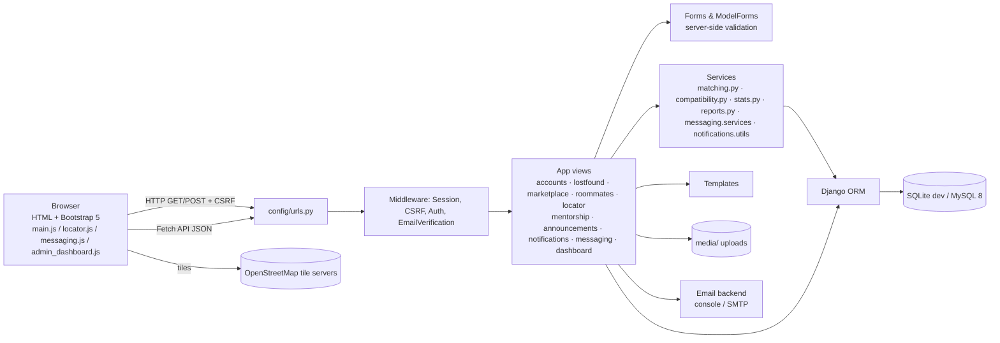

# System Architecture

## Overview
Campus Compass is a server-rendered Django monolith ("MVT" — Model, View, Template) enhanced with progressive AJAX. Every page is a Django template; interactive parts call Django JSON endpoints with the Fetch API.

## Layers
| Layer | Responsibility |
|---|---|
| Presentation | `templates/` (base layout, navbar, footer, per-module pages), `static/css/style.css` design system, vanilla JS modules |
| Routing | `config/urls.py` includes each app's `urls.py` with a namespace |
| Cross-cutting | `EmailVerificationMiddleware`, `admin_required` / `senior_required` decorators, `core.validators`, `core.context_processors.site_context` (unread count) |
| Business logic | Views + pure-Python services (matching, compatibility, statistics, CSV) — easy to unit test |
| Data | Models per app, migrations, `seed_data` management command |

## Request flows
**Live marketplace search** — typing in the search box → `CC.bindLiveFilter` debounces 300 ms → `GET /marketplace/api/search/?q=…` → `filter_products()` builds the queryset → `JsonResponse({results, html, count})` → JS swaps the cards grid.

**Messaging** — `POST /messages/api/<id>/send/` (JSON + `X-CSRFToken`) → participant check → `send_message()` stores the message and creates/refreshes a notification → the other browser polls `GET /messages/api/<id>/messages/?after=<last_id>` every 3 s.

**Lost & found matching** — on create/edit, `record_matches(item)` compares against open items of the opposite type (not the same owner), stores `ItemMatch` rows ≥ 55% and notifies both owners once.

**Roommate compatibility** — computed on the fly for each listed profile vs the viewer's profile: `Σ factor_score × weight` with weights 30/25/15/15/15.

**Admin charts** — `admin_index` renders KPIs server-side; `admin_dashboard.js` fetches `/dashboard/admin/api/stats/` (with the same date-range query) and draws Chart.js charts.

## Security architecture
- Authentication: custom `User` (AbstractUser) + PBKDF2 hashing + validators; login by username/email backend.
- Verification: hashed OTP, expiry, attempt limit; middleware gates the whole app until verified.
- Authorization: login_required on all module views; ownership checks (`_get_own_*`), participant checks on conversations, role decorators for admin/senior areas → 403/404.
- Input: Forms validate everything server-side; templates auto-escape; uploads validated by Pillow + size/extension; external links restricted to http(s) / LinkedIn / GitHub domains.
- Transport/session: CSRF middleware, `require_POST` on mutations, secure cookies + HSTS + SSL redirect when `DEBUG=False`.
- Configuration: secrets and DB credentials from environment / `.env`.

## Deployment view
Development: `runserver` + SQLite. Production suggestion: gunicorn/uwsgi behind nginx, MySQL 8, `collectstatic`, media served by nginx, SMTP email backend, `DJANGO_DEBUG=False`.
